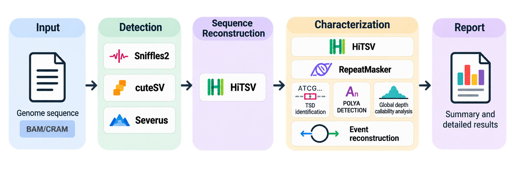

# RetroAtlas

**A long-read sequencing pipeline for retrotransposition detection, reconstruction, biological characterization, and comparative analysis.**

RetroAtlas is a [Snakemake](https://snakemake.readthedocs.io/)-based workflow that processes aligned long-read sequencing data (BAM/CRAM) to investigate retrotransposon insertions in individual genomes, pairs of samples, or larger sample collections. It combines complementary structural variant callers, insertion-sequence reconstruction, repeat annotation, genomic callability assessment, and targeted evidence rescue.

This README first introduces the biological rationale and analysis modes, then provides a step-by-step **execution manual**.

## Contents

- [RetroAtlas overview](#retroatlas-overview)
  - [What does RetroAtlas do?](#what-does-retroatlas-do)
  - [Why RetroAtlas?](#why-retroatlas)
  - [How does RetroAtlas work?](#how-does-retroatlas-work)
  - [Coverage-aware analysis: genomic callability](#coverage-aware-analysis-genomic-callability)
- [Analysis modes](#analysis-modes)
  - [Single](#single-individual-genome-characterization)
  - [Compare](#compare-pairwise-comparison)
  - [Atlas](#atlas-multi-sample-analysis)
  - [Targeted insertion rescue](#targeted-insertion-rescue)
- [Biological reports](#biological-reports)
- [Execution manual](#execution-manual)
  1. [Create a Snakemake environment](#1-create-a-snakemake-environment)
  2. [Obtain the RetroAtlas repository](#2-obtain-the-retroatlas-repository)
  3. [Prepare the sample CSV files](#3-prepare-the-sample-csv-files)
  4. [Configure your analysis](#4-configure-your-analysis)
  5. [Launch the Snakemake workflow](#5-launch-the-snakemake-workflow)
  6. [Common problems and recovery](#6-common-problems-and-recovery)
- [Support](#support)

---

## RetroAtlas overview

### What does RetroAtlas do?

RetroAtlas identifies and characterizes **retrotransposon insertion events** from aligned long-read sequencing data. Rather than reporting only insertion coordinates, the workflow seeks to recover insertion sequences, annotate the corresponding repeat families, characterize event-associated sequence features, and place detected insertions in their genomic context.

Its analytical framework also distinguishes **failure to detect an insertion** from **reliable evidence that an insertion is absent**. This distinction becomes particularly important when comparing samples with heterogeneous sequencing depth or challenging genomic regions.

### Why RetroAtlas?

Retrotransposon analysis involves challenges that are not fully resolved by a single structural variant caller:

- **Complementary detection methods.** Variant callers use different algorithms and evidence models, so their insertion call sets may not completely overlap.
- **Incomplete insertion sequences.** An insertion call does not always provide a complete sequence or sufficient information to interpret its molecular architecture.
- **Uneven genomic coverage.** Low-depth regions can hide heterozygous insertions, while unusually high coverage can reflect problematic mapping in repeated or duplicated regions.
- **Uncertain sample-specificity.** An insertion called in one sample but absent from another sample's initial VCF is not necessarily biologically absent from the second sample.

RetroAtlas addresses these issues by integrating detection, reconstruction, annotation, **coverage-aware interpretation**, and targeted searches for otherwise missed insertion evidence.

### How does RetroAtlas work?

The workflow follows four main stages:

1. **Detection — multiple structural variant callers.** Sniffles2, cuteSV, and Severus analyze BAM/CRAM alignments using complementary calling strategies to identify candidate genomic insertions.
2. **Sequence reconstruction.** Insertion candidates undergo dedicated sequence reconstruction to improve the sequence available for downstream biological interpretation.
3. **Characterization.** HiTSV and RepeatMasker contribute to insertion characterization and repeat annotation. Additional analyses assess features such as **poly(A) tails**, **target-site duplications (TSDs)**, and reconstructed insertion architecture.
4. **Callability and reporting.** Sequencing-depth information is used to assess which genomic regions can be evaluated reliably. The workflow integrates insertion evidence and biological annotations into sample-level and comparative reports.



*Figure 1. Overview of RetroAtlas, from long-read BAM/CRAM alignments through multicaller insertion detection, sequence reconstruction, biological annotation, and reporting.*

### Coverage-aware analysis: genomic callability

A central aspect of RetroAtlas is its **callability framework**: genomic regions are evaluated to determine whether sequencing coverage is sufficient to support reliable interpretation of an insertion's presence or absence.

Two configurable criteria are applied:

- **Minimum depth (`MinDepth`).** At low read depth, a heterozygous insertion may be missed simply because none of the sampled reads represents the insertion-bearing allele.
- **Upper relative depth (`UpperDepthRatio`).** Exceptionally high coverage relative to the applicable depth baseline can indicate ambiguous alignments or repetitive/duplicated sequence, conditions that may increase spurious insertion signals.

For an *ideal heterozygous site*, assuming independent reads, unbiased allele sampling, and an equal probability of observing either allele, the probability of sampling **zero reads from the insertion-bearing allele** at depth $d$ is:

$$
P(\text{no insertion-allele reads}\mid d) = \left(\frac{1}{2}\right)^d
$$

**Illustrative probability by read depth**

| Read depth ($d$) | Probability of observing no insertion-allele reads |
| ---: | ---: |
| 5 | 3.125% |
| 10 | 0.0977% |
| 15 | 0.00305% |
| 20 | 0.0000954% |

> **Interpretation:** This is a *theoretical allele-sampling probability*, **not** an empirically measured false-negative rate or the overall error rate of RetroAtlas. Actual detection sensitivity also depends on alignment quality, insertion structure, caller behavior, read length, allele balance, and other factors.

As an example, `MinDepth: 10` sets a minimum depth criterion, while `UpperDepthRatio: 3` excludes regions exceeding three times the applicable coverage baseline according to the pipeline's callability assessment. The thresholds are configurable and should be interpreted in the context of the dataset.

For comparative analyses, callability is evaluated with respect to the samples being compared. Importantly, **a missing insertion call in a non-callable region should not be interpreted as confirmed absence**.

---

## Analysis modes

RetroAtlas provides three complementary modes for studying retrotransposition at different analytical scales.


*Figure 2. RetroAtlas analysis modes: Single for an individual genome, Compare for two samples, and Atlas for a collection of samples.*

### Single: individual genome characterization

**Single** characterizes the retrotransposition landscape of an individual sample. It integrates insertion detection, sequence reconstruction, repeat classification, event characterization, genome-wide callability, and detailed reporting.

This mode is appropriate when the objective is to investigate **which insertions are present in one genome**, their sequence characteristics, and their distribution across chromosomes and genomic features.

### Compare: pairwise comparison

**Compare** analyzes two samples to distinguish **shared** from **potentially sample-specific** retrotransposon insertions. Rather than treating a missing call in one sample as definitive absence, it incorporates coverage-aware evaluation and targeted evidence rescue.

The analysis initially considers the insertion candidates detected in both samples. Candidate discrepancies can then be revisited using information retained from the structural variant call sets and additional read-level evidence. This helps recover weak signals missed by conventional calling thresholds and improves interpretation of apparent differences between samples.

Use the `comparison.csv` file described in the [execution manual](#3-prepare-the-sample-csv-files) to specify pairs of samples.

### Atlas: multi-sample analysis

**Atlas** extends the comparative strategy to a collection of samples, aiming to assemble a consolidated catalogue of insertion events and evaluate their occurrence across the dataset.

By integrating calls, evidence rescue, and sample-level callability information, Atlas supports analyses of shared and sample-associated retrotransposition patterns while reducing the risk of conflating insufficient evidence with true absence.

### Targeted insertion rescue

In **Compare** and **Atlas**, RetroAtlas preserves information from the initial variant-calling results to re-evaluate candidate insertions that do not have a confident counterpart in another sample. The rescue approach uses **more sensitive read-support criteria** and examines **soft-clipped alignments** and related insertion evidence at the candidate locus.

The purpose of rescue is not to label every initially missing insertion as present. It is to determine whether there is additional supporting evidence that can resolve an apparent discrepancy. Such evidence must still be interpreted together with local genomic callability.


*Figure 3. Conceptual pairwise comparison workflow. Initial insertion sets are combined, unresolved candidates are re-examined using more sensitive evidence, and events are subsequently classified as common or sample-associated.*

#### Example: rescue of an insertion in monozygotic twins

The following read-alignment example illustrates why targeted rescue can matter. An insertion detectable in one monozygotic twin may be absent from the other twin's **initial conventional caller output**, despite supporting alignment evidence at the corresponding locus. Re-examining the candidate in a pairwise analysis can recover evidence that was below the original calling threshold.


*Figure 4. Illustrative alignment view from two monozygotic twins (TWIN-1 and TWIN-2). The highlighted region in TWIN-2 shows local read-level evidence relevant to the rescue of an insertion initially missed by conventional variant calling. This example demonstrates a potential sensitivity benefit; it does not establish a general recovery rate.*

---

## Biological reports

RetroAtlas produces reports that complement event-level results with biologically interpretable summaries. Available visualizations include genome-wide callability, retrotransposon class composition, molecular event architecture, genotype composition, and genomic insertion distribution.

### Genome-wide coverage and callability

Coverage profiles describe which regions satisfy the configured depth limits and identify positions that cannot be assessed reliably. These summaries help users evaluate the genomic fraction suitable for insertion analysis.


*Figure 5. Example callability report displaying chromosome-level depth categories and the proportion of evaluated genomic positions within the configured coverage limits.*

### Repeat classes and event architecture

Insertion reports summarize repeat classes and genotypes and describe features of reconstructed insertion events, providing context beyond a list of genomic coordinates.


*Figure 6. Example biological report summarizing repeat class composition, heterozygous/homozygous insertion genotypes, and event architecture.*

### Chromosomal and genomic distribution

Genome-wide visualizations show where insertions occur, their density across chromosomes, and their relationship to annotated genomic features such as exons, introns, promoters, and intergenic regions.


*Figure 7. Example report showing the positional distribution and chromosomal density of insertions, together with their genomic context.*

---

## Execution manual

A step-by-step guide to preparing sample metadata, configuring a retrotransposition analysis, and launching the **Snakemake** workflow.

## 1. Create a Snakemake environment

RetroAtlas uses the Snakemake workflow system. Create a dedicated environment with Conda or Mamba, then activate it before running the pipeline. Choose **one** of the alternatives below.

**Conda:**

```bash
conda create -n snakemake -c conda-forge -c bioconda snakemake
conda activate snakemake
```

**Mamba:**

```bash
mamba create -n snakemake -c conda-forge -c bioconda snakemake
mamba activate snakemake
```

## 2. Obtain the RetroAtlas repository

Download the repository as a ZIP archive from GitHub, or clone it with Git:

```bash
git clone https://github.com/Francisco100Iniesta/RetroAtlas-Pipeline
cd RetroAtlas-Pipeline
```

### Expected directory layout

The main project directories are:

```text
RetroAtlas-Pipeline/
├── README.md
├── ImageReadme/
│   ├── Figure_1_workflow.png
│   ├── Figure_2_modes.png
│   ├── Figure_3_rescue_strategy.png
│   ├── Figure_4_twin_rescue_example.png
│   ├── Figure_5_callability_report.png
│   ├── Figure_6_repeat_biology_report.png
│   └── Figure_7_genomic_distribution_report.png
├── samples/
├── config/
│   └── configuration.yaml
└── workflow/
    └── Snakefile
```

**Directory roles:** `samples/` contains input metadata, `config/` contains pipeline settings, `workflow/` contains the Snakefile, and `ImageReadme/` stores the figures used in this documentation.

## 3. Prepare the sample CSV files

Create a comma-separated CSV file for the samples you intend to analyze. You can prepare it in a spreadsheet application or a text editor, then save it in the expected `samples/` location. Use the following column headers **exactly as shown**:

```csv
ID,PATH,FILE,REF,SEX,PROCEDENCE
HG002,samples/HG002.bam,bam,/USC/Ref/hg38.fa,U,UNKNOW
HG005,samples/HG005.cram,cram,/USC/Ref/hg38.fa,U,UNKNOW
```

### Field reference

| Setting / field | Description |
| --- | --- |
| `ID` | Unique sample identifier, for example `HG002`. |
| `PATH` | Path to the BAM or CRAM alignment file. |
| `FILE` | Input file format, for example `bam` or `cram`. |
| `REF` | Path to the reference FASTA file. |
| `SEX` | `M` = male, `F` = female, `U` = unknown. |
| `PROCEDENCE` | Sample origin or provenance (e.g., country or region). Keep this header spelling as required by the input format. |

Make sure the alignment files and their indexes are accessible, and use a reference assembly consistent with the alignments. For CRAM inputs, ensure the required reference FASTA is available.

### Optional: pairwise comparison

If you want to compare two samples in the one-to-one comparison mode, create `comparison.csv` using the following structure:

```csv
SampleA,SampleB,ID_Comparison
HG002,HG005,Comparison_HG002_vs_HG005
```

The pairwise sample IDs must match the IDs in your sample manifest.

## 4. Configure your analysis

Modify `config/configuration.yaml` to select the output path, analysis mode, detection thresholds, and optional features.

```yaml
# Output directory
Outpath: /absolute/path/to/results

# Analysis modes: adjust according to your intended run
Single: true
RetroAtlas: false
Compare: true

# Detection and rescue
Rescue_supp: 1
supp: 3
min_svlen: 30
cluster_size: 500

# Callability
MinDepth: 10
UpperDepthRatio: 3

# Optional features
AdaptiveSampling: true
AdaptiveSamplingBED: regions.bed
T2T: true
```

In this configuration example, the `Single` and `Compare` flags are enabled. Adjust the flags to the analyses you wish to run. The **Atlas** mode is represented by the `RetroAtlas` configuration key.

### Detection thresholds

| Setting / field | Description |
| --- | --- |
| `supp: 3` | Example minimum of three supporting reads for an insertion call. |
| `min_svlen: 30` | Example minimum structural-variant length of 30 base pairs. |
| `cluster_size: 500` | Example clustering window of 500 base pairs for grouping insertion signals. |
| `Rescue_supp: 1` | Minimum read support used when attempting to rescue a candidate insertion in comparison or Atlas mode. |
| `MinDepth: 10` | Example minimum depth used in callability assessment. Setting `0` disables the absolute minimum. |
| `UpperDepthRatio: 3` | Upper-depth ratio used by the pipeline's callability logic. |

### Callability and rescue

Callability indicates whether a genomic region has sufficient coverage to evaluate an insertion reliably. In Compare and Atlas modes, the pipeline can revisit candidates with weaker VCF/read evidence and soft-clipping signals, while accounting for local callability when interpreting apparent absences.

The [callability section](#coverage-aware-analysis-genomic-callability) explains the coverage rationale and provides a table of theoretical allele-sampling probabilities at different read depths.

### Optional settings

- Enable `AdaptiveSampling` and specify a BED file using `AdaptiveSamplingBED` when analyzing an adaptive-sampling dataset.
- Set `T2T: true` to enable T2T mode. The default reference mentioned in the original configuration guidance is hg38; ensure the sample `REF` value matches the assembly used for the alignments and the selected analysis mode.
- A seed for aggregated output and an optional setting for intermediate-file cleanup may also be available, depending on the pipeline version. Check the provided configuration for their exact names and behavior.

### Advanced configuration

Additional advanced configuration options are available for event reconstruction, pairwise comparison, and Atlas mode. These settings can be modified to customize the analysis; review the supplied configuration file before changing parameters that affect evidence filtering or event classification.

## 5. Launch the Snakemake workflow

After preparing the CSV files and editing the YAML configuration, activate the Snakemake environment, open a terminal in the repository root, and run:

```bash
snakemake -s workflow/Snakefile --cores 12 --sdm conda -p
```

To preview planned jobs without launching the full workflow, you can first use a dry run:

```bash
snakemake -s workflow/Snakefile --cores 12 --sdm conda -p --dry-run
```

For an HPC cluster that uses Slurm, job submission requires an appropriate Snakemake executor/plugin or site-specific profile; the local command above does not by itself submit jobs to Slurm.

## 6. Common problems and recovery

Check the inputs, paths, and working directory before restarting an interrupted run.

### 1. Avoid ambiguous output paths

Avoid spaces in file and directory names to reduce shell-handling problems. If paths contain spaces, enclose them in quotes where supported.

```bash
# Avoid paths containing spaces
/home/user/test 1/ATLAS/RESULTS 1

# Prefer a path without spaces
/home/user/test_1/ATLAS/RESULTS_1
```

### 2. Recover a failed or interrupted run

If a run stops after a bad or missing input, fix the input or configuration first. You can then re-run jobs that Snakemake marked as incomplete:

```bash
snakemake -s workflow/Snakefile --cores 12 --sdm conda -p --rerun-incomplete
```

### 3. Clear a stale lock only when safe

When no other Snakemake instance is using the working directory and a stale lock prevents execution, run:

```bash
snakemake -s workflow/Snakefile --unlock
```

> **Warning:** Use `--unlock` only after confirming that no other Snakemake process is running in the same working directory.

---

## Support

Check the sample metadata and configuration before starting the workflow. For assistance, contact **francisco.iniestam1@um.es**.
