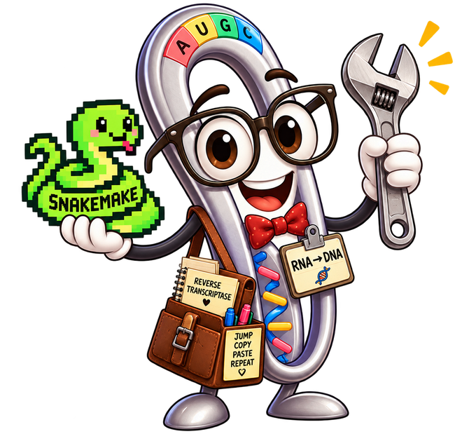

# RetroAtlas — Execution Manual

A step-by-step guide to preparing sample metadata, configuring a retrotransposition analysis, and launching the **Snakemake** workflow.



**Tools:** Snakemake · Conda / Mamba · CSV + YAML

## Contents

1. [Create a Snakemake environment](#1-create-a-snakemake-environment)
2. [Obtain the RetroAtlas repository](#2-obtain-the-retroatlas-repository)
3. [Prepare the sample CSV files](#3-prepare-the-sample-csv-files)
4. [Configure your analysis](#4-configure-your-analysis)
5. [Launch the Snakemake workflow](#5-launch-the-snakemake-workflow)
6. [Common problems and recovery](#6-common-problems-and-recovery)

## 1. Create a Snakemake environment

RetroAtlas uses the Snakemake workflow system. Create a dedicated environment with Conda or Mamba, then activate it before running the pipeline. Choose one of the alternatives below.

```bash
conda create -n snakemake -c conda-forge -c bioconda snakemake
conda activate snakemake
```

```bash
mamba create -n snakemake -c conda-forge -c bioconda snakemake
mamba activate snakemake
```

## 2. Obtain the RetroAtlas repository

Download the repository as a ZIP archive from GitHub, or clone it with Git:

```bash
git clone https://github.com/Francisco100Iniesta/RetroAtlas-Pipeline
cd RetroAtlas-Pipeline
```

### Expected directory layout

The project is organised into three main directories:

```text
RetroAtlas-Pipeline/
├── samples/
├── config/
└── workflow/
    └── Snakefile
```

**Directory roles:** `samples/` contains input metadata, `config/` contains pipeline settings, and `workflow/` contains the Snakefile.

## 3. Prepare the sample CSV files


Create a comma-separated CSV file for the samples you intend to analyse. You can prepare it in a spreadsheet application or a text editor, then save it in the expected samples/ location. Use the following column headers:

```csv
ID,PATH,FILE,REF,SEX,PROCEDENCE
HG002,samples/HG002.bam,bam,/USC/Ref/hg38.fa,U,UNKNOW
HG005,samples/HG005.cram,cram,/USC/Ref/hg38.fa,U,UNKNOW
```

### Field reference

| Setting / field | Description |
|---|---|
| `ID` | Unique sample identifier, for example HG002. |
| `PATH` | Path to the BAM or CRAM alignment file. |
| `FILE` | Input file format, for example bam or cram. |
| `REF` | Path to the reference FASTA file. |
| `SEX` | M = male, F = female, U = unknown. |
| `PROCEDENCE` | Sample origin or provenance (e.g., country or region). |

### Optional: pairwise comparison

If you want to compare two samples in the one-to-one comparison mode, create comparison.csv using the following structure:

```csv
SampleA,SampleB,ID_Comparison
HG002,HG005,Comparison_HG002_vs_HG005
```

The pairwise sample IDs must match the IDs in your sample manifest.

## 4. Configure your analysis


Modify config/configuration.yaml to select the output path, analysis mode, detection thresholds and optional features.

```yaml
# Output directory
Outpath: /absolute/path/to/results

# Analysis modes: adjust according to your intended run
Single: true
RetroAtlas: false
Compare: true

# Detection and rescue
Rescue_supp: 1
supp: 3
min_svlen: 30
cluster_size: 500

# Callability
MinDepth: 10
UpperDepthRatio: 3

# Optional features
AdaptiveSampling: true
AdaptiveSamplingBED: regions.bed
T2T: true
```

### Detection thresholds

| Setting / field | Description |
|---|---|
| `supp: 3` | Example minimum of three reads supporting an insertion call. |
| `min_svlen: 30` | Example minimum structural-variant length of 30 base pairs. |
| `cluster_size: 500` | Example clustering window of 500 base pairs for grouping signals across haplotypes or samples. |
| `Rescue_supp: 1` | Minimum read support used when attempting to rescue a candidate insertion in comparison or Atlas mode. |
| `MinDepth: 10` | Example minimum depth used in callability assessment. Setting 0 disables the absolute minimum. |
| `UpperDepthRatio: 3` | Upper-depth ratio setting used by the pipeline's callability logic. |

### Callability and rescue

Callability indicates whether a genomic region has sufficient evidence for evaluating an insertion. In comparison mode, the pipeline may attempt to rescue an insertion signal in a region initially considered non-callable. If no supporting evidence is found, the result should distinguish between absence of evidence and a region that cannot be evaluated reliably.

### Optional settings

Enable AdaptiveSampling and specify a BED file with AdaptiveSamplingBED.

Set T2T: true to enable T2T mode. The default reference is hg38.

A seed is described for aggregated output, and an optional cleanup setting is mentioned for intermediate files.

### Advanced configuration

Additional advanced configuration options are available for event reconstruction, pairwise comparison and Atlas mode. These settings can also be modified to customise your analysis.

## 5. Launch the Snakemake workflow


After preparing the CSV files and editing the YAML configuration, activate the snakemake environment, open a terminal in the repository root and run:

```bash
snakemake -s workflow/Snakefile --cores 12 --sdm conda -p
```

For an HPC cluster that uses Slurm, job submission requires an appropriate Snakemake executor/plugin or site-specific profile; the local command above does not by itself submit jobs to Slurm.

## 6. Common problems and recovery


Check the inputs and working directory before restarting an interrupted run.

### 1. Avoid ambiguous output paths

Avoid spaces in file and directory names to reduce shell-handling problems. If paths contain spaces, enclose them in quotes.

```bash
# Avoid paths containing spaces
/home/user/test 1/ATLAS/RESULTS 1

# Prefer a path without spaces
/home/user/test_1/ATLAS/RESULTS_1
```

### 2. Recover a failed or interrupted run

If a run stops after a bad or missing input, fix the input or configuration first. You can then re-run any jobs that Snakemake marked as incomplete:

```bash
snakemake -s workflow/Snakefile --cores 12 --sdm conda -p --rerun-incomplete
```

### 3. Clear a stale lock only when safe

When no other Snakemake instance is using the working directory and a stale lock prevents execution, run:

```bash
snakemake -s workflow/Snakefile --unlock
```

> **Warning:** Use `--unlock` only after confirming that no other Snakemake process is running in the same working directory.

---

## Support

Check the sample metadata and configuration before starting the workflow. For assistance, contact **francisco.iniestam1@um.es**.
